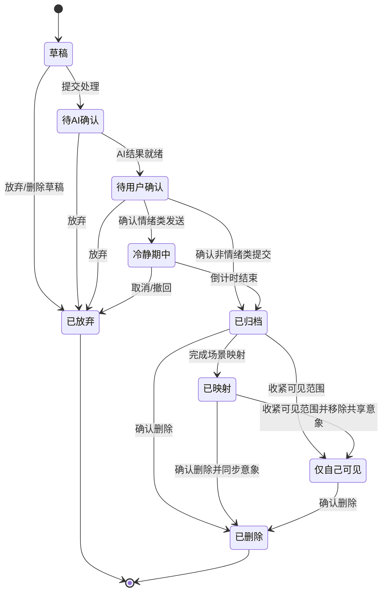

# Memory Garden PRD 需求解析

> 唯一产品事实来源：`Memory Garden 新版 PRD` V4.0（前端双端重构版）  
> 解析范围：需求澄清、边界、流程、状态、优先级与验收；不包含业务代码。  
> 术语：页面 A＝意象展示端；页面 B＝文本接收—解析工作端；“关系组”＝一个独立关系领地内的授权成员集合。

## 0. 读取到的输入

- 已完整读取指定 PRD 的第 1—15 章，包括目标、用户、双页面架构、端到端流程、A/B 页需求、Agent、导航、视觉动效、隐私安全、无障碍、优先级、验收、指标与答辩口述。
- 本文必须覆盖用户指定的 11 类分析，并把第 13 章转成带唯一编号的测试清单。
- 强制边界：不修改 PRD；不写业务代码；不将 P2 当作首版必做；不把“完成对齐”解释为“关系已修复”；页面 A 不得泄露敏感原文。
- 对 PRD 未明确但实现必需的内容，只能记为“实现建议”或“未决问题”，不能冒充明确需求。

## 1. 产品目标、非目标、安全边界与目标用户

### 1.1 产品目标

1. 建立低门槛、多模态的关系素材接收工作区，支持文本、语音、图片和音频。
2. 由 Agent 在用户确认前完成风险识别、表达辅助、歧义补全、创意转译和认知对齐。
3. 将用户确认后的素材映射为持续成长、可解释的花园、老屋及扩展记忆大陆。
4. 分离沉浸式感受与理性复盘：A 页看意象，B 页看原文、版本与解析。
5. 用真实数据驱动、可追溯的场景变化体现 Agent 价值，而不是只展示聊天机器人。

### 1.2 非目标

- 不裁判争吵，不判断对错，不劝分或劝和。
- 不提供心理诊断、治疗或危机干预。
- 不做陌生人匹配、公开广场、排行榜、打卡惩罚或可刷取奖励。
- AI 不得未经用户确认发送、覆盖或公开原始表达。
- Demo 不追求完整 3D 开放世界；优先验证 2D 场景成长和双向对齐闭环。

### 1.3 安全边界

- 检出自伤、轻生或严重创伤相关高危信号后，暂停润色、认知对齐和养成奖励，展示非诊疗边界说明并分流至本地化、可验证的官方援助资源及紧急求助建议。
- 高危内容不得生成花朵、唱片或其他浪漫化意象。
- 正式援助资源必须来自可验证、可配置的数据源；PRD 仅定义能力边界，未提供具体资源清单。
- 情绪表达必须保留原文与润色版本的审计记录，允许用户选择版本；确认后进入可取消/撤回的冷静期。
- 认知对齐只能由用户主动发起；双方输入隔离，本人核验前不得向对方展示原文或解析。
- 默认最小可见范围；关系组严格隔离；敏感原文、语音和图片支持单条权限与删除。

### 1.4 目标用户

- 高中生、大学生及其可使用智能设备的家长。
- 恋爱中或长期相处的伴侣。
- 挚友、室友等稳定亲密关系成员。
- 义务教育阶段、没有独立设备的儿童不是当前版本优先用户。

## 2. 页面职责与不可跨越的数据边界

| 维度 | 页面 A：意象展示端 | 页面 B：文本接收—解析工作端 |
|---|---|---|
| 用户心智 | 看共同留下的内容及关系空间如何生长 | 认真录入、确认、查原话、处理沟通错位 |
| 核心职责 | 2D 场景、意象、摘要、授权媒体、成长解释 | 多模态录入、AI 预处理、版本选择、冷静期、档案、对齐、设置 |
| 允许展示 | 确认后的意象、中性/转译摘要、原图及其元数据、授权音频、完整计划详情、中性对齐结果摘要 | 原始输入、转写、AI 润色、最终选择、建议、状态时间线、拆解与错位、权限和删除管理 |
| 禁止展示 | 吐槽/争吵原文；对齐原始输入；拆解表与错位高亮全文；未结束冷静期或未确认内容 | 不得在本人核验前向对方泄露其原文或解析；不得出现裁判式结论 |
| 跨页入口 | 固定“查看文字档案与对齐记录”；“查看来源档案” | “返回记忆空间”；“在空间中查看” |

不可跨越的数据展示边界：

1. A 页任何入口、物件详情、字幕、空状态、通知或深链落点，都不能直接或间接复现敏感原文及认知对齐拆解表。
2. 未经用户确认、冷静期未结束或仅自己可见的内容，不能生成关系组共享意象。
3. “仅自己可见”进入私人档案，不生成共享意象；是否允许私人视角意象，PRD 未定义。
4. 对齐完成后，A 页只能显示中性结果摘要和日期；不得展示双方原话、拆解字段或暗示责任归属。
5. 对方只能看到发送者最终确认版本；原始草稿默认不可见，开放与否由发送者权限决定。
6. 关系组切换必须同步切换 A/B 数据，任何来源档案、音频、深链或场景对象均不得跨组解析。

## 3. 信息架构、导航、核心路径与上下文

### 3.1 信息架构与一级导航

- 页面 A 常驻导航：场景切换、声音、帮助、关系成员、**查看文字档案与对齐记录**。
- 页面 B 常驻导航：返回记忆空间、当前关系组选择，以及四个一级页签：
  1. 新建记录；
  2. 普通档案；
  3. 认知对齐；
  4. 关系设置。
- 新建记录提供四个录入入口：写一段话、说给花园听、添加照片、添加音频；录入前选择普通记忆、情绪表达、计划/心愿或发起认知对齐。系统可建议分类，但用户可修改。

### 3.2 核心用户路径

1. **情绪表达**：B 新建 → 文本/语音 → 安全筛查 → 原文/润色/建议 → 用户选版本或放弃 → 冷静期 → 可撤回 → 归档 → 映射 → A 意象。
2. **计划/心愿**：B 新建 → 识别并抽取字段 → 单问题补全歧义 → 用户确认原句与结构化计划 → 归档 → 心愿树节点。
3. **图片**：B 上传 → 补充元数据/可见范围 → 预告并选择花朵/花瓣/树叶 → 确认归档 → A 新增对应意象。
4. **音频**：B 上传 → 补充标题、类型、作者/录制者、备注、权限 → 确认归档 → A 生成唱片 → 用户点击后播放。
5. **普通档案**：B 列表筛选 → 详情追溯输入/版本/选择/时间线/映射 → 可删除并同步场景。
6. **认知对齐**：用户主动发起 → 双方异步隔离输入 → 各自核验自身拆解 → 并排对照 → 保存/补充/共同纪要/暂时结束 → 可生成中性纪念意象。
7. **沉浸回看**：进入 A → 漫游/点击意象 → 查看转译摘要或授权媒体 → 必要时深链到 B 查看来源。

### 3.3 深链与上下文保持

- A 意象“查看来源档案”→ B 直接打开对应记录。
- B 记录“在空间中查看”→ A 定位并高亮对应物件。
- 心结幻影→ B 发起对齐并带入关联事件，但不得自动复制对方原文。
- 返回时保留：B 的筛选条件与滚动位置；A 的场景视角；音频播放状态。
- 页面 B 返回 A 时保留用户上次场景与视角。
- 切换场景时，正在播放的记忆音频应保留，或明确询问是否继续播放。

## 4. P0/P1/P2 功能矩阵

> “验收依据”中的 MG 编号对应第 11 节；“PRD §x”表示该项由相应章节明确要求但不完全属于第 13 章原始验收条目。

### 4.1 P0：必须完成

| 功能 | 页面 | 输入 | 输出 | 前置条件 | 异常路径 | 验收依据 |
|---|---|---|---|---|---|---|
| A/B 双端导航与数据边界 | A+B | 当前关系组、导航动作 | 正确页面与隔离数据 | 已选关系组 | 无权限/失效深链不得泄露数据 | MG-A-001~003；MG-X-001 |
| 四类录入入口 | B | 文本、语音、图片、音频 | 对应草稿 | 可新增的活跃领地 | 不支持格式、录入失败、高危命中进入安全分流 | PRD §5.1、§12 |
| 情绪版本选择与冷静期 | B | 原文/转写、AI 候选 | 最终确认版本、审计记录、倒计时 | 安全筛查通过 | 放弃→已放弃；冷静期取消→不归档/不映射 | MG-I-001~002；MG-X-002 |
| 计划歧义识别补全 | B | 用户原句 | 结构化计划+保留原句 | 安全筛查通过 | 关键字段未确认→不得完整归档 | MG-I-003 |
| 普通档案列表与详情 | B | 已保存记录、筛选条件 | 可追溯列表、详情和时间线 | 有查看权限 | 空状态；记录已删/无权时拒绝展示 | MG-A-003；PRD §5.6 |
| 双人认知对齐闭环 | B | 双方独立输入、本人核验 | 并排对照、错位标记、可选结果 | 用户主动发起 | 单方未提交/核验→继续隔离；可暂时结束 | MG-C-001~004 |
| 花园与老屋 2D 场景 | A | 当前关系组已映射数据 | 两套视觉主题 | 已载入关系组 | 空关系组保持简洁，不造假素材 | PRD §6.1、§8.3、§12 |
| 图片驱动意象增长 | A+B | 已确认图片、意象选择 | 新花/花瓣/树叶并可定位 | 图片归档且可共享 | 删除→移除/空位；失败不得出现幽灵意象 | MG-G-001~002 |
| 音频映射与播放 | A+B | 已确认授权音频 | 唱片、播放器 | 格式受支持且有权限 | 加载/播放失败可恢复；不得自动播放 | MG-G-003；MG-X-003 |
| 固定进入 B 的按钮 | A | 点击导航 | 进入 B | 无 | 按钮不可被场景遮挡 | MG-A-002；MG-U-003 |
| 高危关键词 Demo 安全分流 | B | Demo 高危触发文本 | 暂停普通流程、边界提示、援助入口 | 命中模拟规则 | 不润色、不对齐、不奖励、不映射；资源不可硬编码未核验信息 | MG-X-004 |

### 4.2 P1：建议完成

| 功能 | 页面 | 输入 | 输出 | 前置条件 | 异常路径 | 验收依据 |
|---|---|---|---|---|---|---|
| 心愿树阶段成长 | A | 已确认计划/心愿数量 | 枝叶节点与阶段变化 | 已归档、可映射 | 删除/权限变化后可解释地同步 | PRD §6.2~6.3 |
| 双人桌宠状态同步 | A | 关系组数据与交互状态 | 休息/好奇/活跃/庆祝 | 有当前关系组 | 长期无互动只休息、不死亡；可一键休眠 | PRD §6.6 |
| 唱片 AI 叙事字幕 | A | 已确认音频及转译结果 | 标注“由记录转译”的字幕 | 有播放权限 | 可关字幕/背景音乐；来源跳转 B | PRD §6.4 |
| 和解纪念碑/心结幻影 | A+B | 双方确认的对齐/长期隔阂 | 中性纪念意象/处理入口 | 对齐已双方核验或有对应隔阂数据 | 不宣称关系修复；不展示原文 | MG-C-004；PRD §6.2 |
| A/B 深链定位 | A+B | 记录 ID/意象 ID/关联事件 | 精确打开、高亮或发起上下文 | 同组且有权限 | 失效/越权链接安全失败 | PRD §8.2 |
| 记忆帷幕与双向归档演示 | A+B | 用户/双方状态操作 | 本人模糊视角/历史只读 | 归档状态及相应确认 | 帷幕仅影响本人；双向归档后停止新增成长 | PRD §10.2 |

### 4.3 P2：未来扩展（非首版必做）

| 功能 | 页面 | 输入 | 输出 | 前置条件 | 异常路径 | 验收依据 |
|---|---|---|---|---|---|---|
| 完整记忆大陆与奇遇 | A | 当前关系组数据、漫游操作 | 大尺度 2D 漫游和数据驱动奇遇 | 后续范围立项 | 不得出现战斗、奖励、排行或陌生玩家 | PRD §5.5、§6.5、§12 |
| 多主题领地与自定义花种 | A+B | 用户主题选择 | 视觉外壳变化 | 后续范围立项 | 不得改变底层数据和核心交互 | PRD §6.1、§12 |
| 真实多人账号与完整同步 | A+B | 账号、关系组、消息 | 多人实时/异步同步 | 后端、身份和权限方案明确 | 冲突、断线、越权策略待定义 | PRD §12；未决问题 |
| 守园者有限陪伴 | 待定 | 待定义 | 待定义 | 后续范围立项 | 不得越过诊疗/裁判边界 | PRD §12；未决问题 |
| 商用级合规、安全审计、援助资源对接 | 全局 | 合规规则、审计事件、验证资源 | 正式安全与资源能力 | 法务、安全及区域资源方案 | 资源失效、区域缺失需安全降级 | PRD §10、§12；未决问题 |

## 5. 记录状态机

### 5.1 状态语义

| 状态 | 含义 |
|---|---|
| 草稿 | 用户开始录入但尚未进入 AI 处理 |
| 待 AI 确认 | 已提交给 AI 预处理，结果尚未稳定呈现/确认 |
| 待用户确认 | AI 结果已呈现，等待用户确认分类、版本、字段或权限 |
| 冷静期中 | 情绪内容已确认但尚未正式归档，可取消/撤回 |
| 已归档 | 正式保存，按权限可见，尚未或无需完成场景映射 |
| 已映射 | 已归档且对应场景意象已生成/同步 |
| 已放弃 | 用户在草稿、待确认或冷静期中终止流程 |
| 仅自己可见 | 归档后变更为私人档案，不生成共享意象 |
| 已删除 | 归档后的记录被删除，对应意象同步移除或替换 |

### 5.2 合法流转

说明：PRD 的文字定义明确“可从草稿、待确认、冷静期中进入已放弃”，其中“待确认”可合理覆盖“待 AI 确认”和“待用户确认”；本文据此画出两条流转。PRD 未明确 `仅自己可见` 能否恢复为关系组可见，也未定义删除恢复，故不画反向流转。

## 6. 六类完整流程

### 6.1 情绪表达

1. 在 B 选择情绪表达并输入文本或语音转写。
2. 素材归档 Agent 建草稿，安全层先筛查高危信号。
3. 非高危时，表达辅助 Agent 识别情绪强度、误解风险和攻击/歧义表达，不作诊断。
4. 展示原话、AI 润色候选、沟通建议与改动说明。
5. 用户选择使用润色、保留原文或放弃；AI 不得覆盖原文。
6. 确认后进入冷静期；Demo 建议 60 秒（可配置的演示默认值，不是正式固定时长）。
7. 冷静期可取消/撤回；到期后按权限归档，对方只见最终确认版本。
8. 归档后才可转译并映射；A 只呈现转译摘要/意象，不显示原文。

### 6.2 计划/心愿

1. 在 B 选择计划/心愿并输入原句。
2. Agent 抽取日期、时间、时区、地点、参与人、动作、出发/到达语义、提醒方式。
3. 对歧义采用单问题、可选择方式逐步追问。
4. 关键字段未确认时不得标记为完整。
5. 用户同时核验原句与结构化结果，确认后归档。
6. A 生成心愿树枝叶；点击可看时间、摘要和完整计划详情，但不显示敏感吐槽原文。

### 6.3 图片

1. 在 B 添加照片。
2. 填写图片、事件名称、时间（可选“不记得”）、地点（可选）、一句话备注、可见范围；PRD 将部分字段表述为“必填或建议”，具体必填性待确认。
3. 系统预告意象，用户可在花朵、花瓣、树叶中改选。
4. 确认并归档后，A 新增对应意象；点击显示原图、时间、地点和事件备注。
5. 删除图片后，档案与场景同步，意象淡出、移除或变为纪念空位；不能引发整棵树惩罚性枯萎。

### 6.4 音频

1. 在 B 添加 MP3 等常见格式音频。
2. 填写标题、类型（喜欢的音乐/用户录音/语音回忆/演唱片段）、演唱者或录制者、事件备注、可见范围。
3. 确认归档后，A 生成实体唱片。
4. 用户点击唱片后才放入留声机并播放；禁止自动播放。
5. 支持暂停、继续、进度拖动、音量、字幕、关闭背景音乐；切换场景时保留播放或明确询问。
6. AI 叙事标明“由记录转译”；查看原始来源必须跳转 B。

### 6.5 普通档案

1. 归档内容进入 B 的列表，至少显示标题/摘要、提交人、时间、素材类型、状态、可见范围；情绪标签仅展示用户确认过的结果。
2. 可按成员、类型、时间、情绪标签、映射状态、可见范围筛选。
3. 详情展示原始输入、转写、AI 润色、最终选择、沟通建议、状态时间线和对应意象。
4. 单条权限受控；删除前确认，删除后即时同步移除或替换意象。

### 6.6 认知对齐

1. 仅由用户在 B 主动发起；提示围绕事实、感受、期待，不诱导站队。
2. 双方独立、异步输入；双方提交并各自核验前，原文互不可见。
3. Agent 拆解表层话语/事实、当下情绪、内在诉求、未说出口期待、对对方话语的理解、不确定/待确认项。
4. 每人先核验自己的解析，可确认、修改或标记“不是我的意思”；只有本人确认版本进入对照。
5. 桌面左右双栏；移动端 A/B 分段切换并有错位摘要。错位用标签、描边或图标等非纯颜色方式标记。
6. 结果操作：保存、各自补充、生成双方确认的共同纪要、暂时结束且不强求和解。
7. 双方核验完成后，A 可生成纪念碑/修复光点或处理心结幻影；这只代表完成了一次确认流程，**不代表关系已修复**。

## 7. 意象映射与真实数据驱动的成长

### 7.1 映射表

| 已确认输入/事件 | A 页意象 | 可展示内容 | 禁止内容 |
|---|---|---|---|
| 计划、共同目标、心愿 | 心愿树枝叶 | 时间、事件摘要、完整计划 | 敏感原文 |
| 图片 | 花朵/花瓣/树叶 | 原图、时间、地点、备注 | 无关敏感文本 |
| MP3/用户录音 | 唱片+留声机 | 授权音频、标题、备注、转译字幕 | 未授权音频/原始敏感文本 |
| 普通短句/情绪记录 | 植物、天气、光影 | AI 转译叙事摘要 | 原始吐槽/争吵文本 |
| 双方确认的认知对齐 | 纪念碑/修复光点 | 中性结果摘要、日期 | 原文、拆解表、责任判断 |
| 温暖旧记忆 | 记忆生灵 | 转译小故事、来源日期 | 敏感原文 |
| 未完成长期隔阂 | 心结幻影 | 中性提示、对齐入口 | 对方原文、裁判结论 |
| 被遗忘的心愿 | 心愿异象 | 心愿摘要、继续处理入口 | 未授权敏感信息 |

### 7.2 明确由真实数据驱动的变化

- 每张已确认图片 → 一朵花/一片花瓣/一片树叶。
- 每条已确认计划/心愿 → 一个心愿树枝叶节点。
- 每段已确认音频 → 一张可选择唱片。
- 每次双方核验完成的对齐 → 纪念碑纹理、光点或环形刻痕。
- 已确认记录的情绪趋势 → 天气、光线、风声和色温；不得把负面情绪等同于坏花园。
- 关系组交互数据 → 桌宠休息、好奇、活跃、共同庆祝等状态；不得施压或制造内疚。
- 长期无互动 → 停止生长但不清零、不死亡。
- 删除素材 → 对应意象淡出或纪念空位，不造成惩罚性整体衰败。
- 图片数量阶段：0—3 花苞期、4—9 初花期、10—19 繁花期、20+ 按季节或月份聚合为花簇；阈值可配置。
- 每次映射成功 → 短暂、可跳过的生长提示，并可查看“为什么出现这个变化”。

## 8. 隐私、关系隔离、领地、危机、删除与权限

### 8.1 隐私和关系组隔离

- 每段关系是独立领地，A/B 同步使用当前关系组，禁止混合展示。
- 默认最小可见范围；用户确认前不向其他成员展示。
- 可见性明确区分：仅自己可见、关系组可见、双方确认后可见。
- 敏感原文、语音、图片均有单条权限和删除能力。
- 对齐双方在提交并核验前相互隔离；只有本人确认解析可进入对照。

### 8.2 领地状态

| 状态 | 明确行为 |
|---|---|
| 活跃共建 | 可新增记录、发起对齐、继续场景生长 |
| 双向归档 | 双方确认后停止新增和生长，历史只读保留 |
| 冷静销毁 | 归档后可发起整体删除，进入 7 天冷静期，可撤销 |
| 记忆帷幕 | 归档后可在本人设备模糊场景，只影响本人视角 |

### 8.3 危机提示

- Demo 仅模拟触发和安全分流，不作诊断。
- 命中后暂停润色、对齐与养成奖励，说明非诊疗边界。
- 正式资源须本地化、官方、可验证、可配置；PRD 未提供地区映射、审核责任人和更新机制，属于未决问题。
- 高危输入不得进入普通创意转译、共享展示或浪漫化意象。

### 8.4 删除与权限规则

- 草稿/待确认/冷静期可放弃；冷静期撤回后对方不可见且 A 不生成意象。
- 单条归档记录可即时删除，需二次确认，并同步移除或替换意象。
- 归档后可改为仅自己可见；共享意象必须相应撤下。
- 整体领地删除只在归档后发起，进入 7 天冷静期且可撤销。
- 原始草稿默认不向对方开放；如开放，须由发送者权限决定。

## 9. 响应式、无障碍、性能、音频与动效

### 9.1 响应式与布局

- 至少覆盖 375、768、1024、1440 px；不得出现横向页面滚动。
- A→B 固定按钮：桌面右上角，移动端位于底部安全区上方，不遮挡主要内容/场景物件。
- 对齐：桌面左右双栏；移动端 A/B 分段切换，并提供错位摘要总览。

### 9.2 无障碍

- 正文默认不小于 16 px；正常文字对比度至少 4.5:1。
- 交互目标至少 44×44 px，并保持足够间距。
- 按钮有可见文字或可访问名称；装饰图标对辅助技术隐藏；功能图标不用 Emoji 代替。
- A 页物件可键盘聚焦、回车打开，提供可见焦点环；唯一操作不能只在 hover 出现。
- 弹窗打开后焦点进入弹窗，关闭返回触发物，无键盘陷阱。
- 状态、情绪和错位类型使用文字/图标/描边等组合，颜色不是唯一编码。
- 漫游、拖拽、缩放均有按钮和键盘替代。
- 自动循环内容有暂停/停止；获得焦点或开启减少动态效果时停止。

### 9.3 性能

- 长列表分页或虚拟化。
- 图片使用 WebP/AVIF、懒加载并预留尺寸，避免布局跳动。
- 复杂更新可显示短暂“正在整理这份记忆”，但成长动画不得阻塞操作。

### 9.4 音频

- 页面不自动播放音频；氛围音默认静音或沿用用户上次设置。
- 记忆唱片和氛围音分别提供音量与关闭控制。
- 记忆音频支持播放/暂停/继续/拖动进度/音量/字幕/关闭背景音乐。
- 场景切换时保留播放，或明确询问是否继续。

### 9.5 动效与 `prefers-reduced-motion`

- 动效只解释真实数据变化；单视图同时突出 1—2 个关键动效。
- 点击反馈立即出现；成长动画可跳过、不阻塞。
- 提供“减少动态效果”开关并遵循 `prefers-reduced-motion`；关闭视差、摇摆、长距离移动，直接呈现最终状态，功能与内容不得缺失。

## 10. 明确需求 / 实现建议 / 未决问题

| 明确需求（PRD 事实） | 实现建议（可替换 Demo 默认值） | 未决问题（需产品确认） |
|---|---|---|
| A/B 分离，A 不展示敏感原文与拆解表 | 深链使用不可猜测的同组记录标识，并在解析前二次校验关系组与权限 | 深链失效、无权、记录已删时的正式文案 |
| 情绪内容需版本选择、冷静期和撤回 | Demo 冷静期采用 PRD 建议的 60 秒，并通过配置项注入 | 正式版默认时长、关系组可配置范围、修改权限 |
| 计划关键歧义确认后才能完整归档 | Demo 将未完成计划标记为待确认并保留草稿 | 哪些字段属于“关键字段”；不同计划类型的最低完整度 |
| 图片可映射为花朵/花瓣/树叶 | Demo 默认建议“花朵”，用户可改选 | 图片字段中哪些必填、哪些仅建议；“不记得”时间的排序方式 |
| 支持 MP3 等常见格式，禁止自动播放 | Demo 至少覆盖 MP3；其余格式能力检测后提示 | 正式格式、大小、时长、编码和版权规则 |
| 双方输入隔离且各自核验后再对照 | 对照前使用参与者级状态门禁，任何单方缺失都不返回对方数据 | 多于两名成员时认知对齐是否仍限双人 |
| 已确认数据驱动成长，阈值可配置 | Demo 使用 0—3/4—9/10—19/20+ 默认阈值 | 阈值配置主体、历史数据重算与阶段回退规则 |
| 删除素材需同步意象，允许移除或纪念空位 | Demo 对普通删除采用淡出后空位，避免突变 | 谁决定“移除”或“纪念空位”；删除后审计保留范围 |
| 单条删除即时；整体删除有 7 天冷静期 | Demo 对整体删除显示明确到期时间与撤销入口 | 整体删除的双方同意、到期执行、备份和恢复策略 |
| 高危时暂停普通流程并导流官方资源 | Demo 用显式测试触发器验证分流；资源从配置读取，不写死未经核验号码 | 支持地区、资源审核/更新责任、无可用资源时降级策略 |
| 返回时保留筛选、滚动、视角、音频状态 | Demo 以页面会话状态保存，刷新持久化暂不假定 | 跨设备、跨会话、刷新后的保留范围与时效 |
| 关系组严格隔离 | 所有查询、缓存键、媒体 URL 与深链均带关系组权限校验 | 真实账号、邀请、退出、成员移除、所有权转移规则 |
| 页面响应式、键盘可用、减少动态效果 | 将 375/768/1024/1440 与键盘/读屏/减动作为验收测试矩阵 | 目标浏览器、设备、读屏软件和性能预算 |
| P2 是未来扩展 | 首版界面不放置会误导为可用功能的 P2 入口 | P2 是否需要仅做答辩占位或完全隐藏 |

## 11. 第 13 章验收标准：可测试清单

### 11.1 页面边界

- [ ] **MG-A-001**：遍历 A 页主导航、所有场景物件、弹层、字幕和深链返回路径，均看不到吐槽/争吵原文及认知对齐拆解表。
- [ ] **MG-A-002**：在 375、768、1024、1440 px 下，A 页始终存在可聚焦、可点击的“查看文字档案与对齐记录”按钮，且不被物件或安全区遮挡。
- [ ] **MG-A-003**：在 B 页打开一条有 AI 处理的记录，可追溯原始输入、AI 版本、用户最终选择及完整状态时间线。

### 11.2 录入与确认

- [ ] **MG-I-001**：提交需润色的情绪文本后，页面同时提供“使用润色版本”“保留原始版本”“放弃本次发送”，三条路径分别落入正确状态且原文不被覆盖。
- [ ] **MG-I-002**：情绪内容进入冷静期后执行取消；验证对方不可见、记录不进入共享归档、A 页不生成意象。
- [ ] **MG-I-003**：提交存在关键歧义的计划并拒绝/遗漏关键字段确认；验证系统不能将其标记为完整计划。

### 11.3 场景成长

- [ ] **MG-G-001**：新增并确认一张图片后，A 页出现一项可定位的新花朵/花瓣/树叶，且来源指向该图片记录。
- [ ] **MG-G-002**：删除一张已映射图片后，对应意象按配置移除或转为空位；刷新 A/B 后档案与场景保持一致。
- [ ] **MG-G-003**：新增并确认一段授权音频后出现唱片；音频不自动播放；点击后可播放、暂停并关闭。
- [ ] **MG-G-004**：触发任一场景变化后，用户可查看其来源记录与 Agent 的简短“为什么”解释，且 A 页不泄露敏感原文。

### 11.4 认知对齐

- [ ] **MG-C-001**：仅一方提交或仅一方核验时，以另一方身份访问会话，无法看到前者的原文和解析。
- [ ] **MG-C-002**：双方提交并各自核验后，对照页至少展示一种明确标记的错位类型，且标记不只依赖颜色。
- [ ] **MG-C-003**：用户修改 Agent 对自己的解读并确认后，最终对照展示修改版本，不展示被替换版本为本人结论。
- [ ] **MG-C-004**：检查对齐流程、结果页及 A 页纪念意象文案，不出现“胜负、得分、责任方”或“关系已修复”等裁判/过度推断表达。

### 11.5 可用性

- [ ] **MG-U-001**：仅用键盘完成 A/B 主要导航、聚焦并打开意象、操作并关闭弹窗、进入并查看档案；焦点可见且关闭弹窗后返回触发物。
- [ ] **MG-U-002**：开启产品“减少动态效果”及系统 `prefers-reduced-motion` 后，视差/摇摆/长距离动画停止或直接到终态，信息与功能不缺失。
- [ ] **MG-U-003**：在至少 375 px 手机视口检查所有一级页面，无横向滚动，固定按钮不遮挡主要内容和关键操作。

### 11.6 由强制安全与边界要求补充的测试

- [ ] **MG-X-001**：切换关系组后，A/B 列表、详情、场景、媒体、缓存和深链同步切组；尝试访问另一组记录时不返回任何内容。
- [ ] **MG-X-002**：验证情绪原文与润色版均保留于授权审计视图，对方默认只见最终确认版本，AI 不自动发送或覆盖。
- [ ] **MG-X-003**：首次进入 A 页及切换场景时，记忆音频与氛围音均不被强制自动播放；氛围音遵循静音或上次设置。
- [ ] **MG-X-004**：触发 Demo 高危规则后，普通润色、对齐、奖励和意象映射均暂停；页面显示非诊疗边界及由可验证配置源提供的援助入口，不输出诊断或浪漫化意象。
- [ ] **MG-X-005**：状态、情绪和错位信息均同时使用文字与图标/描边等编码，移除颜色后仍可理解。

## 12. 交叉检查结果

- **P2 边界**：完整记忆大陆、主题自定义、真实多人账号、守园者、商用级合规/资源对接均明确列为未来扩展，未写入 P0 首版必做。
- **对齐语义**：所有描述均限定为“双方核验/流程完成/生成中性纪念意象”，未把它表述为“关系已修复”。
- **A 页敏感数据**：A 页只允许确认后的意象、摘要、授权媒体及非敏感详情；原始吐槽/争吵、对齐输入、拆解表与未完成冷静期内容均明确禁止。
- **AI 权限**：未赋予 AI 自动发送、覆盖或公开原始表达的能力；保留用户确认、版本选择与撤回。
- **危机边界**：仅定义 Demo 触发和安全分流，不诊断、不浪漫化；正式援助信息被标记为需可验证配置源，未硬编码具体资源。
- **事实与建议分离**：第 10 节按“明确需求 / 实现建议 / 未决问题”分栏；Demo 默认值均标明可替换。

## 13. 产物、检查结果、待确认项、下一步所需输入

### 产物

- 本文档：完整的 PRD 需求解析、优先级矩阵、状态机、业务流程、映射机制、安全/权限边界、非功能要求和编号验收清单。

### 检查结果

- 已覆盖用户指定的 11 项内容。
- 已将 PRD 第 13 章全部验收要求转成唯一编号清单，并补充强制安全/边界检查。
- 未修改原 PRD，未写业务代码，未引入 PRD 外的正式业务事实。

### 待确认项

1. 正式冷静期时长、可配置范围及谁有权修改。
2. 图片字段的必填/建议划分；音频格式、大小、时长和版权限制。
3. 计划关键字段的最低完整度及不同计划类型规则。
4. 真实账号、关系组邀请/退出/成员移除/所有权转移和多人同步冲突规则。
5. 仅自己可见能否恢复共享；私人内容是否允许仅本人可见的 A 页意象。
6. 单条删除后的审计保留、纪念空位策略；整体删除的同意和恢复规则。
7. 正式援助资源的地区范围、验证标准、维护责任和失效降级方案。
8. 上下文状态跨刷新、跨会话、跨设备的保留范围。
9. 目标浏览器/设备/辅助技术矩阵、明确性能预算。
10. P2 能力在首版应完全隐藏还是保留不可交互的答辩说明。

### 下一步所需输入

- 产品负责人对上述待确认项的决策；若继续进入设计阶段，还需确认首版是否严格按 P0，或包含哪些 P1 项。
